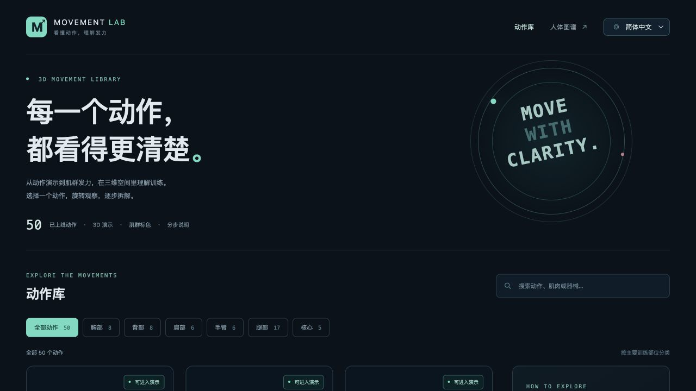
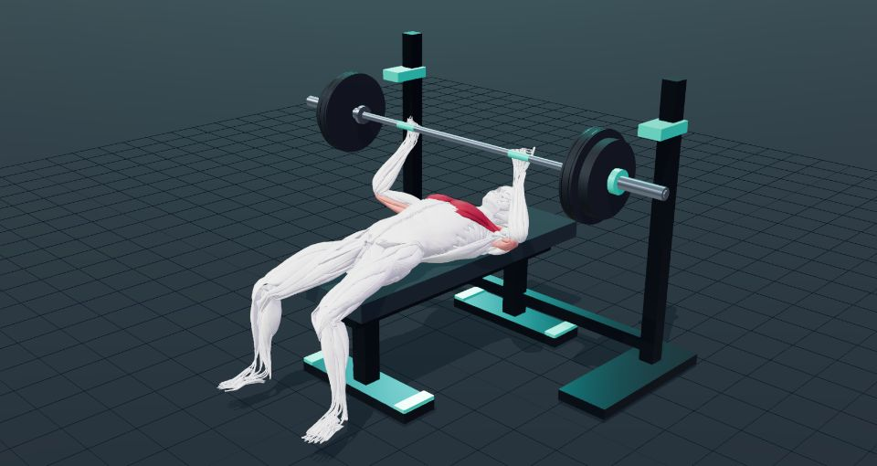

# Movement Lab · 3D 健身动作演示

[简体中文](README.md) · [English](README.en.md) · [Español](README.es.md) · [Français](README.fr.md) · [Deutsch](README.de.md) · [Português](README.pt.md) · [日本語](README.ja.md) · [한국어](README.ko.md)

**看清动作怎么做，也看懂哪些肌肉参与。**

Movement Lab 是在浏览器中运行的 3D 健身动作库，提供 **50 个动作、6 个训练部位、8 种语言**，覆盖徒手、杠铃、哑铃、绳索与常见器械训练。

**[在线体验](https://movement-lab.pages.dev/)** · [杠铃卧推](https://movement-lab.pages.dev/exercises/bench/)





## 主要功能

- 可旋转、缩放、切换视角的 3D 动作演示。
- 深红标记主要发力肌群，浅红标记辅助或稳定肌群，其他部位为白模。
- 播放、暂停、重新开始、进度拖动和 0.5×／1×／1.5× 慢放与加速。
- 准备姿势、分阶段要领、常见错误与参考资料。
- 按部位筛选，按动作、肌肉或器械搜索。
- 简体中文、英语、西班牙语、法语、德语、葡萄牙语、日语和韩语。
- Three.js + Vite 纯静态网站，无需自建后端、账号或 AI API 密钥。

## 动作范围

| 部位 | 数量 | 示例 |
|---|---:|---|
| 胸部 | 8 | 卧推、俯卧撑、地板飞鸟 |
| 背部 | 8 | 引体向上、高位下拉、绳索划船 |
| 肩部 | 6 | 哑铃肩推、侧平举、器械肩推 |
| 手臂 | 6 | 哑铃弯举、锤式弯举、绳索下压 |
| 腿部 | 17 | 深蹲、硬拉、箭步蹲、器械腿弯举 |
| 核心 | 5 | 平板支撑、死虫式、鸟狗式 |

## 本地运行

需要 Node.js **20.19+（20.x）或 22.12+**，以及支持 WebGL2 的浏览器。

```bash
git clone https://github.com/alex-chan/movement-lab.git
cd movement-lab/web
npm ci
npm run dev
```

打开终端显示的地址，默认 `http://localhost:5173/`。模型和 Draco 解码资源已包含，无需下载 Blender 源文件。请通过 HTTP 服务访问，不要直接双击 HTML 文件。

## 检查与部署

在 `web/` 目录执行：

```bash
npm run check:movements
npm run check:i18n
npm run build
npm run check:seo
npm run preview
```

将实际公开网址写入本地 `web/.env.production` 的 `SITE_URL` 后再构建；该文件不提交到 Git。将 `web/dist/` 部署到 Cloudflare Pages 等静态托管服务，保留独立页面和真实 404 响应。当前线上版本使用直接上传，GitHub 提交不会自动发布。

构建包含静态教学文字、多语言元信息与结构化数据。配置 `SITE_URL` 后生成 canonical、hreflang 和 sitemap；未配置时默认 noindex。详见 [开发指南](docs/DEVELOPMENT.md)、[SEO 配置](web/README-SEO.md) 和 [国际化说明](web/README-I18N.md)。

## 演示范围与来源

动画为程序化教学示意，未模拟真实负重或软组织力学。颜色表示肌群作用，**不是实测激活强度**；白色部位也可能参与稳定。内容不能代替个体化训练指导或医疗建议。

原人体图谱保留在 `/anatomy/`，作为补充工具。其知识内容和讲解仍为英语／印地语，不属于动作库八语言翻译范围。

基于 [SeemaBansal1/3d-human-body-anatomy](https://github.com/SeemaBansal1/3d-human-body-anatomy) 扩展，保留原作者提交历史及 [原图谱文档](README-ANATOMY.md)。模型来自 Z-Anatomy／BodyParts3D，保留各自的署名与相同方式共享许可。原器官图层包含 **CC BY-NC 4.0 肾脏模型，商业发布前必须移除或替换**。详见 [来源与许可](CREDITS.md)。
